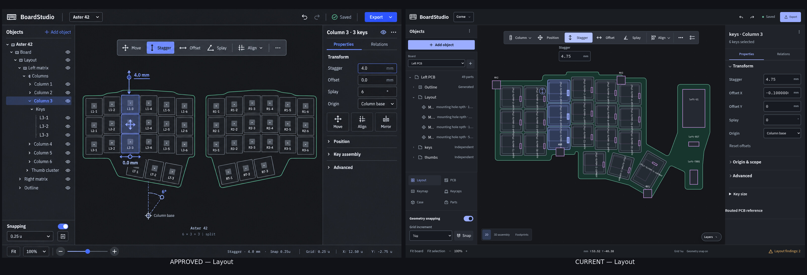
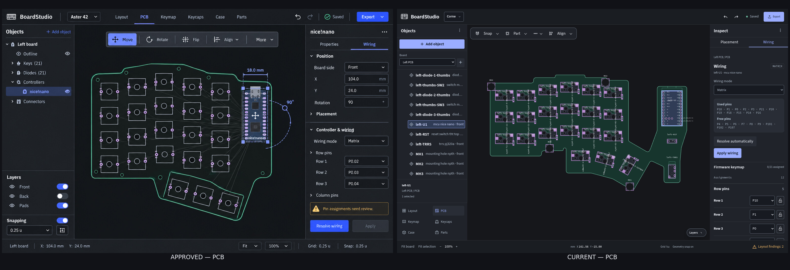
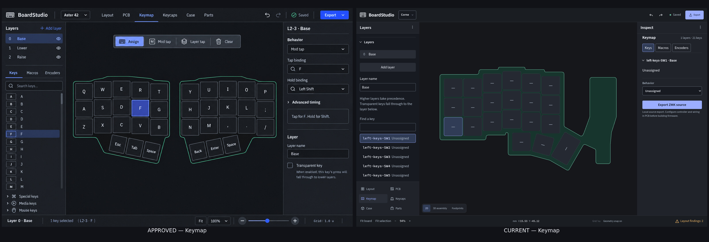
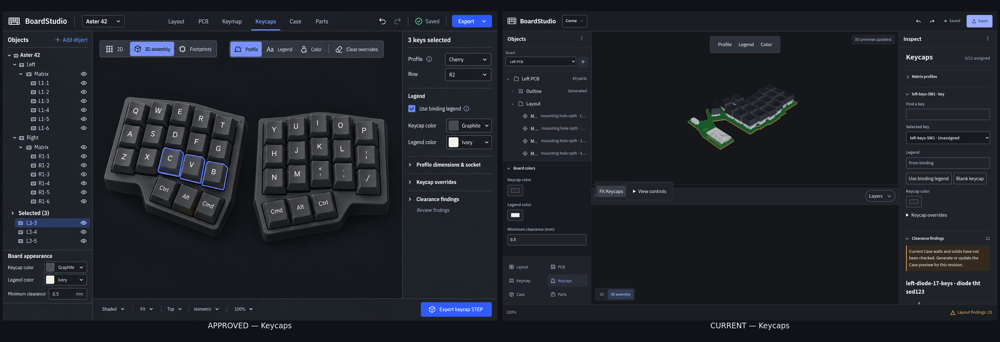
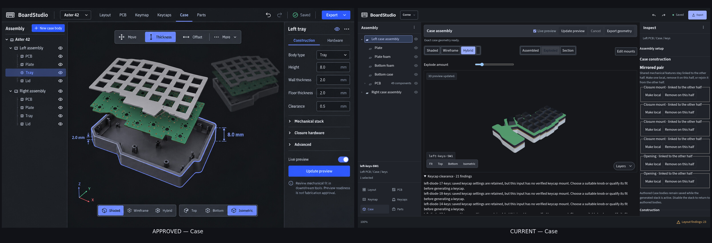
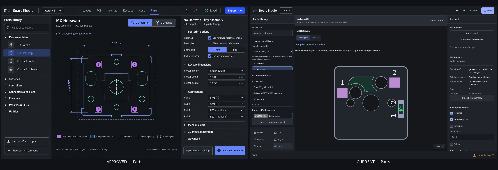
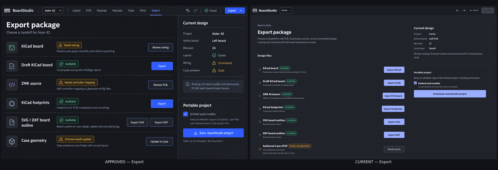
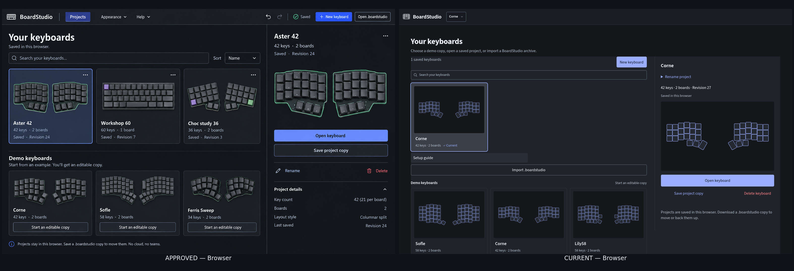
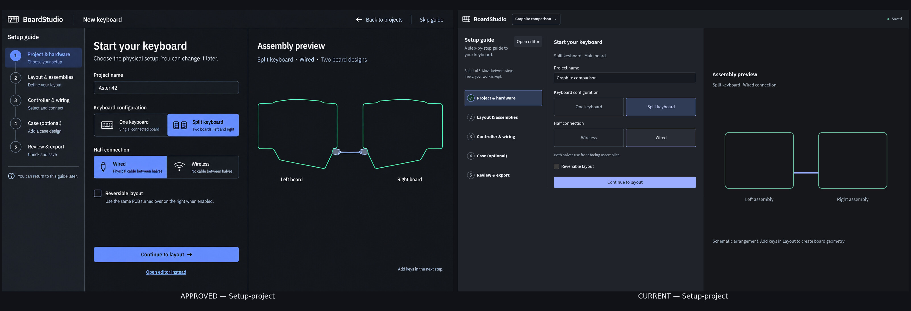
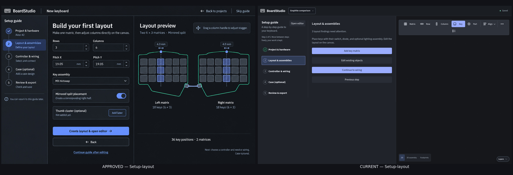

# Graphite comparison gallery
Approved on the left; current implementation on the right. Each image retains full reference resolution. Geometry, assignments and project counts vary by fixture; see [the drift report](README.md) for classifications and exclusions.

## Layout

[Open full-size comparison](compare-Layout.jpg)

## PCB

[Open full-size comparison](compare-PCB.jpg)

## Keymap

[Open full-size comparison](compare-Keymap.jpg)

## Keycaps

[Open full-size comparison](compare-Keycaps.jpg)

## Case

[Open full-size comparison](compare-Case.jpg)

## Parts

[Open full-size comparison](compare-Parts.jpg)

## Export

[Open full-size comparison](compare-Export.jpg)

## Browser

[Open full-size comparison](compare-Browser.jpg)

## Setup-project

[Open full-size comparison](compare-Setup-project.jpg)

## Setup-layout

[Open full-size comparison](compare-Setup-layout.jpg)

