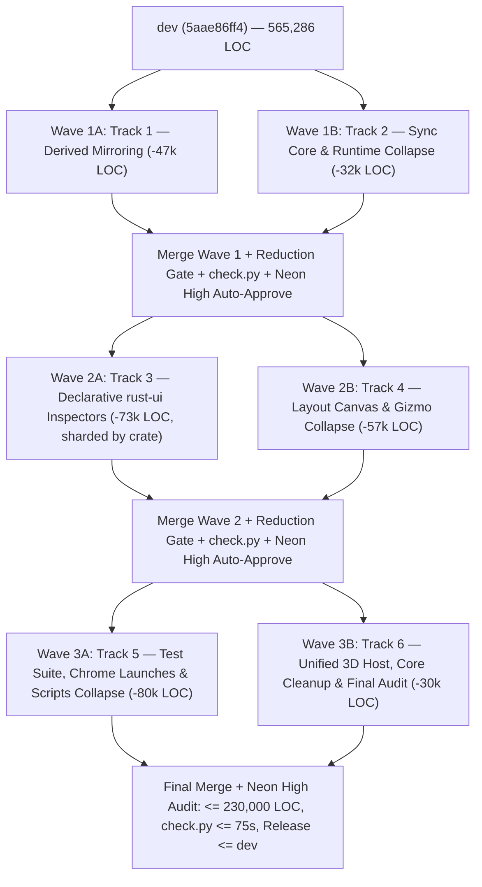

# BoardStudio Clean-Slate Codebase Reduction Program

**Required Git Base:** `dev` (`5aae86ff4b6d8cb05fae8e5d9ec71818ddf64bf4`)  
**Status:** Active — replaces the "Remaining implementation program" section of [aaa-simplification-roadmap.md](../aaa-simplification-roadmap.md) and supersedes the unmerged `refactor/simplify-implementation-wave` branch (`85278fa21`).  
**Primary Objective:** Reduce BoardStudio from **565,286 LOC** on `dev` to **≤ 230,000 LOC** (**≥ −335,000 net LOC**), cut full `check.py` wall time to **≤ 60–75s**, and ensure build times, WASM bundle sizes, and startup latency are strictly **better than `dev`**.

---

## 1. Why the Previous Attempt (`refactor/simplify-implementation-wave`) Failed

Before starting any track, every orchestrator and implementer MUST understand the exact failure modes of the abandoned `refactor/simplify-implementation-wave` branch (`e07a60889..85278fa21`, 282 commits, ~5.5 hours):

1. **Silent pivot from deletion to bug-for-bug preservation.** The planning agent rewrote the roadmap into a defensive checklist requiring 100% preservation of legacy mirror quirks (false-parent decoys, tombstone ID reservations, exact changed-ID ordering, full legacy mirror test suites as untouchable oracles, and v7→v8 staged migration). You cannot collapse a 52k-LOC reconciler to 3k LOC while preserving every historical bug and internal quirk of the 52k-LOC reconciler.
2. **Wrapping instead of replacing.** `core/crates/mirrored-half` kept `reconcile/` (16,208 LOC, *+606*), `inverse/` (5,757 LOC), `prepare.rs` (1,171 LOC), `membership_view.rs` (1,185 LOC), and `lifecycle/` (~2,800 LOC). A new `format8/` codec was bolted on *outside* the old reconciler instead of replacing it.
3. **Adding abstractions beside monoliths.** `web/crates/layout-core` added `canvas_pointer.rs` (+526 LOC) while `layout_transform_toolbar/` stayed at 10,919 LOC (*+22*). `web/crates/ui-shared` added +553 LOC of field hooks while `case/mechanical_settings*` shed only 753 of 12,975 LOC (−5.8%).
4. **Unchecked test and script bloat.** Test Rust grew by **+6,421 net LOC** (reaching 53% of the Rust repo), 0 of 12 per-crate Chrome launches were retired, and 6 one-off trial/benchmark scripts (+2,344 LOC) plus a 1,399-line markdown inventory were committed.
5. **Net regression across the board.** The branch finished **+10,422 tracked Rust/script LOC** (+1,657 Prod Rust, +6,421 Test Rust, +2,625 Scripts), **+2.21 MB** larger Core worker WASM, **+33s** slower fresh release build, and **+79 ms** slower cold startup.

**This program exists to make those five failure modes mechanically impossible.**

---

## 2. Exact Baseline on `dev` (`5aae86ff4`) vs. Program Targets

Measured on `dev` (`5aae86ff4`) across all tracked `.rs` files and `scripts/*.{py,sh}`:

| Bucket | `dev` Prod | `dev` Test | `dev` Total | Target Total | Target Net Delta |
|---|---:|---:|---:|---:|---:|
| `core/` | 77,335 | 101,416 | 178,751 | ≤ 72,000 | **−106,751** |
| `web/` | 159,229 | 113,833 | 273,062 | ≤ 90,000 | **−183,062** |
| `application/` | 3,337 | 4,604 | 7,941 | ≤ 3,500 | **−4,441** |
| `scripts/` | — | — | 26,263 | ≤ 8,000 | **−18,263** |
| `cad/` *(already reduced from 172k)* | 24,567 | 16,360 | 40,927 | ≤ 32,000 | **−8,927** |
| `footprints/` + `renderer/` + `contracts/` | 25,490 | 12,694 | 38,184 | ≤ 24,500 | **−13,684** |
| **TOTAL** | **290,116** | **248,907** | **565,286** | **≤ 230,000** | **≥ −335,286 (−59%)** |

---

## 3. Discrete Implementation Plans

Read [00-agent-guardrails-and-gate.md](00-agent-guardrails-and-gate.md) FIRST — it is mandatory for every track.

| Track | Plan Document | Owned Domain | `dev` LOC | Hard Ceiling | Min Net Reduction | Depends On |
|---|---|---|---:|---:|---:|---|
| **0** | [00-agent-guardrails-and-gate.md](00-agent-guardrails-and-gate.md) | Non-negotiable rules & [check_reduction.py](check_reduction.py) | — | — | — | Required by all |
| **1** | [01-derived-mirroring-replacement.md](01-derived-mirroring-replacement.md) | `core/crates/mirrored-half`, mirror glue in `engine`/`model`/`kernel`, mirror tests | ~52,000 | ≤ 5,000 | **≥ −47,000** | None (Wave 1) |
| **2** | [02-sync-main-thread-core-and-runtime-collapse.md](02-sync-main-thread-core-and-runtime-collapse.md) | `web/src/core_worker.rs`, `web/crates/runtime`, `web/crates/host`, `application`, `ui-shared/src/draft_edits*`, `*_queued_edit_tests` | ~50,000 | ≤ 18,000 | **≥ −32,000** | None (Wave 1) |
| **3** | [03-declarative-rust-ui-inspectors.md](03-declarative-rust-ui-inspectors.md) | `ui-shared` schema molecules + `case`, `parts`, `pcb`, `keycaps`, `keymap`, `library`, `web/src/presentation/inspector*` | ~113,000 | ≤ 40,000 | **≥ −73,000** | Track 2 (sync commit API) |
| **4** | [04-layout-canvas-and-gizmo-collapse.md](04-layout-canvas-and-gizmo-collapse.md) | `layout-objects`, `layout`, `layout-core`, `web/src/presentation/editor*` | ~85,000 | ≤ 28,000 | **≥ −57,000** | Track 1 & Track 2 |
| **5** | [05-test-suite-and-ci-collapse.md](05-test-suite-and-ci-collapse.md) | `core/tests/`, 12 per-crate Chrome launches in `scripts/check.py`, `scripts/` bloat | ~110,000* | ≤ 30,000* | **≥ −80,000*** | Tracks 1–4 (incremental per wave, finalized in Wave 3) |
| **6** | [06-shared-3d-host-and-final-cleanup.md](06-shared-3d-host-and-final-cleanup.md) | 3D WebGL2 viewer unification, `core/crates/{mechanical,kernel,artifact}` trim, worktree hygiene, final release audit | ~60,000* | ≤ 30,000* | **≥ −30,000*** | Tracks 1–5 |

*\*Track 5 and Track 6 counts exclude lines already deleted inside Tracks 1–4 so totals are not double-counted.*

---

## 4. Multi-Provider Routing & Review Protocol

Never let one provider both invent policy and self-grade its own diffs. Split **Orchestration**, **Fast Fenced Implementation**, and **High-Leverage Architectural Review** across all three providers (`serviceTier: "default"`, `fastMode: false`):

| Provider & Model | Role | Assigned Tracks | Guardrail |
|---|---|---|---|
| **Antigravity — Orchestrator (Neon)** (`thought_level: "low"`) | **Sole Coordinator, Gatekeeper & Integrator** | Runs Waves 1–3, writes strict anti-drift briefs, merges, runs `check_reduction.py` + full `check.py`, prunes worktrees | Owns all merges & vetoes scope creep; posts a 5-line wave scoreboard and **auto-advances** to the next wave once the Neon High Wave-End Gate Review approves |
| **Codex — GPT-6.2 Sol** (`reasoningEffort: "low"`) | **Primary Fast Architectural Implementer** | Track 1 (Mirroring), Track 4 (Layout Canvas & Gizmos) | Must receive explicit Deletion Manifest + Banned Patterns + `check_reduction.py` gate verbatim; zero compat shims |
| **Codex — GPT-6.1 Terra** (`reasoningEffort: "low"`) | **Fast Multi-File & Mechanical Deletion Implementer** | Track 2 (Sync Core & Runtime), Track 3A/3C/3D (UI molecules + `parts`/`pcb`), Track 5A (`core/tests/` & Chrome launches), Track 6B (`core/` trim) | Strictly fenced by `check_reduction.py` manifest & negative LOC limits |
| **Claude — Opus 5.5** (`effort: "medium"`) | **Conserved Read-Only Architectural & Anti-Bloat Reviewer** | Read-only diff review on Track 1, Track 2, Track 4 (high-risk cutovers only) | Conserves Opus quota; verifies correctness AND flags any sneaky wrappers, compat shims, or missed deletions |
| **Claude — Sonnet 5.5** (`effort: "low"` / `"medium"`) | **Secondary UI & Script Implementer** | Track 3B (`case`), Track 5B (`scripts/`) | Must pass `check_reduction.py` per sub-track |
| **Antigravity — Gemini 4 Neon** (`thought_level: "high"`) | **Read-Only Wave-End Gate Auditor & Auto-Approver** | Audits completed Wave 1, Wave 2, and Wave 3 against all discrete plans + `check_reduction.py` + `check.py` | Compares actual diff & metrics vs. plan; issues **`AUTO-APPROVE NEXT WAVE`** (unattended advance) or **`BLOCK`** (1 bounded fix retry, then escalate) |
| **Antigravity — Gemini 4 Neon** (`thought_level: "low"` / `"medium"`) | **Cross-Crate Web/3D Consolidation Worker** | Track 3E+3F (`keycaps`/`keymap`/`library`/`presentation`), Track 6A (unified 3D host) | Must pass `check_reduction.py` per sub-track |

---

## 5. Recommended Wave Execution Schedule



- **Wave 1 (2 parallel worktrees):** Track 1 (Core) and Track 2 (Runtime/Worker) are file-disjoint except for the thin `CoreEngine` call boundary. Integrate, pass `check_reduction.py` + `check.py`, then run a read-only `Gemini 4 Neon (high)` audit comparing what was built against the plan; on `VERDICT: AUTO-APPROVE NEXT WAVE`, launch Wave 2 unattended.
- **Wave 2 (3–4 parallel worktrees):** Track 3A (`ui-shared` schema molecules, fast first commit), then fan out Track 3B (`case`), Track 3C (`parts` + `pcb`), Track 3D (`keycaps` + `keymap` + `library`), and Track 4 (`layout*`). Never exceed 4 active worktrees. After merging and passing `check_reduction.py` + `check.py`, a read-only `Gemini 4 Neon (high)` audit compares against the plan and auto-approves Wave 3 unattended.
- **Wave 3 (2 parallel worktrees):** Track 5 (retire remaining Chrome launches, prune `core/tests/`, slim `scripts/`) and Track 6 (unify 3D viewer, trim `core/crates/{mechanical,kernel,artifact}`, prune stale worktrees). Conclude with a final read-only `Gemini 4 Neon (high)` audit against the cumulative program goals.

---

## 6. Mandatory Agent Handoff Prompt Template

When launching **any** AI agent (coordinator or implementer) on a track, paste this block at the top of its prompt verbatim:

```text
You are executing Track <N> of BoardStudio's Clean-Slate Codebase Reduction Program.
Base commit: <SHA> (must be clean dev or the merged prior wave).

MANDATORY READING (read both completely before editing a single file):
1. docs/plans/clean-slate-reduction/00-agent-guardrails-and-gate.md
2. docs/plans/clean-slate-reduction/<TRACK_FILE>.md
3. AGENTS.md and CODING_STANDARDS.md

NON-NEGOTIABLE COMPLETION CONTRACT:
- This is a DELETION-FIRST clean-slate rewrite. BoardStudio is pre-release (not live).
  ZERO backward-compatibility shims, ZERO v7 migration/recovery code, ZERO dual-path wrappers.
- You MUST delete every file listed in the track's Mandatory Deletion Manifest.
- UNATTENDED FILE DELETION (zero approval prompts): NEVER run rm, rm -rf, or git rm.
  Delete files by moving them out of the worktree into /tmp/boardstudio-trash/<track>/
  (mkdir -p /tmp/boardstudio-trash/<track> && mv <paths> /tmp/boardstudio-trash/<track>/)
  and staging with git add -u.
- You MUST pass docs/plans/clean-slate-reduction/check_reduction.py against <BASE_SHA>
  with strictly NEGATIVE net Production Rust LOC and strictly NEGATIVE net Test Rust LOC
  meeting the track's Hard Budget.
- Do NOT rewrite scope, add "preserve legacy quirk" requirements, or treat deleted subsystem
  narrative tests as untouchable oracles. If a legacy quirk would cost >100 LOC to preserve,
  STOP and ask the user in 3 lines — never silently build machinery for it.
- Do NOT commit exploratory scripts, benchmark harnesses, or >100-line .evidence/ inventories.
- Run focused crate tests in your worktree under the shared build lock
  (~/.cache/tmp/boardstudio-build.lock, BOARDSTUDIO_BUILD_LOCK_FD=9, TMPDIR="$HOME/.cache/tmp").
  Reserve full check.py for integration after the wave merges.
- Your final report MUST paste the raw output of check_reduction.py.
```
