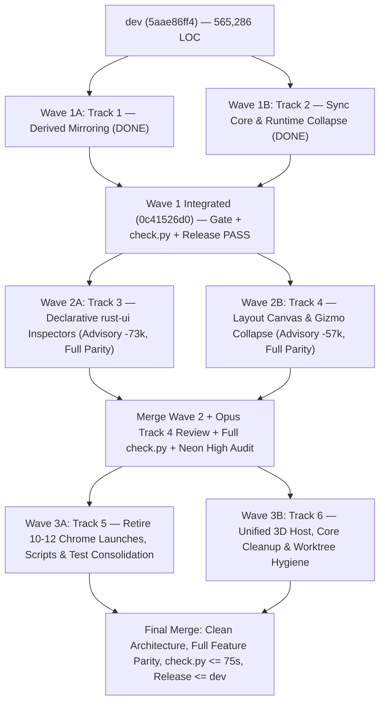

# BoardStudio Clean-Slate Codebase Reduction Program

**Required Git Base:** `dev` (`5aae86ff4b6d8cb05fae8e5d9ec71818ddf64bf4`)  
**Status:** Active — Wave 1 (`0c41526d0`) **COMPLETED** (`-30,354` Prod Rust, `-79,456` Test Rust, `24.94 MB` release page WASM, zero `m1_core_worker_bg.wasm`, Neon High `APPROVE`). Wave 2 & Wave 3 updated to enforce clean architecture, full feature parity, CI/runtime velocity, and hard anti-bloat (`net < 0` / `--must-delete`) with advisory numeric LOC stretch targets.  
**Primary Objective:** Replace multi-layer plumbing, workers, prop-bags, and redundant test/script chrome with clean, maintainable Rust/Dioxus architecture while **preserving 100% of user-facing `PRODUCT.md` capabilities and domain invariants**; cut full `check.py` wall time to **≤ 60–75s**; ensure build times, WASM bundle sizes, and startup latency are strictly **better than `dev`**; and eliminate all bloat strictly (`--must-delete`, `--forbid-symbol`, net `< 0`), targeting **~230,000–255,000 LOC** as an advisory stretch ceiling.

---

## 1. Why the Previous Attempt (`refactor/simplify-implementation-wave`) Failed

Before starting any track, every orchestrator and implementer MUST understand the exact failure modes of the abandoned `refactor/simplify-implementation-wave` branch (`e07a60889..85278fa21`, 282 commits, ~5.5 hours):

1. **Silent pivot from deletion to bug-for-bug preservation.** The planning agent rewrote the roadmap into a defensive checklist requiring 100% preservation of legacy mirror quirks (false-parent decoys, tombstone ID reservations, exact changed-ID ordering, full legacy mirror test suites as untouchable oracles, and v7→v8 staged migration). You cannot collapse a 52k-LOC reconciler to 3k LOC while preserving every historical bug and internal quirk of the 52k-LOC reconciler.
2. **Wrapping instead of replacing.** `core/crates/mirrored-half` kept `reconcile/` (16,208 LOC, *+606*), `inverse/` (5,757 LOC), `prepare.rs` (1,171 LOC), `membership_view.rs` (1,185 LOC), and `lifecycle/` (~2,800 LOC). A new `format8/` codec was bolted on *outside* the old reconciler instead of replacing it.
3. **Adding abstractions beside monoliths.** `web/crates/layout-core` added `canvas_pointer.rs` (+526 LOC) while `layout_transform_toolbar/` stayed at 10,919 LOC (*+22*). `web/crates/ui-shared` added +553 LOC of field hooks while `case/mechanical_settings*` shed only 753 of 12,975 LOC (−5.8%).
4. **Unchecked test and script bloat.** Test Rust grew by **+6,421 net LOC** (reaching 53% of the Rust repo), 0 of 12 per-crate Chrome launches were retired, and 6 one-off trial/benchmark scripts (+2,344 LOC) plus a 1,399-line markdown inventory were committed.
5. **Net regression across the board.** The branch finished **+10,422 tracked Rust/script LOC** (+1,657 Prod Rust, +6,421 Test Rust, +2,625 Scripts), **+2.21 MB** larger Core worker WASM, **+33s** slower fresh release build, and **+79 ms** slower cold startup.

**This program exists to make those five failure modes mechanically impossible.**

---

## 2. Exact Baseline on `dev` (`5aae86ff4`) vs. Advisory Program Targets

Measured on `dev` (`5aae86ff4`) across all tracked `.rs` files and `scripts/*.{py,sh}`. Numeric ceilings below are **advisory stretch targets** (never chase them by dropping user-facing features or domain tests); the **hard gate** is architectural replacement + feature parity + net non-growth / `--must-delete` / CI & release velocity:

| Bucket | `dev` Prod | `dev` Test | `dev` Total | Advisory Stretch Total | Advisory Net Delta |
|---|---:|---:|---:|---:|---:|
| `core/` | 77,335 | 101,416 | 178,751 | ≤ 72,000 | **−106,751** |
| `web/` | 159,229 | 113,833 | 273,062 | ≤ 90,000 | **−183,062** |
| `application/` | 3,337 | 4,604 | 7,941 | ≤ 3,500 | **−4,441** |
| `scripts/` | — | — | 26,263 | ≤ 8,000 | **−18,263** |
| `cad/` *(already reduced from 172k)* | 24,567 | 16,360 | 40,927 | ≤ 32,000 | **−8,927** |
| `footprints/` + `renderer/` + `contracts/` | 25,490 | 12,694 | 38,184 | ≤ 24,500 | **−13,684** |
| **TOTAL** | **290,116** | **248,907** | **565,286** | **≤ 230,000–255,000** | **≥ −310,000–−335,286** |

---

## 3. Discrete Implementation Plans

Read [00-agent-guardrails-and-gate.md](00-agent-guardrails-and-gate.md) FIRST — it is mandatory for every track.

| Track | Plan Document | Owned Domain | `dev` LOC | Advisory Target Total | Advisory Net Reduction | Depends On / Status |
|---|---|---|---:|---:|---:|---|
| **0** | [00-agent-guardrails-and-gate.md](00-agent-guardrails-and-gate.md) | Hard anti-bloat + feature preservation rules & [check_reduction.py](check_reduction.py) | — | — | — | Required by all |
| **1** | [01-derived-mirroring-replacement.md](01-derived-mirroring-replacement.md) | `core/crates/mirrored-half`, mirror glue in `engine`/`model`/`kernel`, mirror tests | ~52,000 | ≤ 5,000 | **≥ −47,000** | **COMPLETED** (`0c41526d0`, Wave 1) |
| **2** | [02-sync-main-thread-core-and-runtime-collapse.md](02-sync-main-thread-core-and-runtime-collapse.md) | `web/src/core_worker.rs`, `web/crates/runtime`, `web/crates/host`, `application`, `ui-shared/src/draft_edits*`, `*_queued_edit_tests` | ~50,000 | ≤ 18,000 | **≥ −32,000** | **COMPLETED** (`0c41526d0`, Wave 1) |
| **3** | [03-declarative-rust-ui-inspectors.md](03-declarative-rust-ui-inspectors.md) | `ui-shared` schema molecules + `case`, `parts`, `pcb`, `keycaps`, `keymap`, `library`, `web/src/presentation/inspector*` | ~113,000 | ≤ 40,000 | **≥ −73,000** | Track 2 (Wave 2A — **FEATURE PARITY REQUIRED**) |
| **4** | [04-layout-canvas-and-gizmo-collapse.md](04-layout-canvas-and-gizmo-collapse.md) | `layout-objects`, `layout`, `layout-core`, `web/src/presentation/editor*` | ~85,000 | ≤ 28,000 | **≥ −57,000** | Track 1 & 2 (Wave 2B — **FEATURE PARITY REQUIRED**) |
| **5** | [05-test-suite-and-ci-collapse.md](05-test-suite-and-ci-collapse.md) | `core/tests/`, 10–12 per-crate Chrome launches in `scripts/check.py`, `scripts/` bloat | ~110,000* | ≤ 30,000* | **≥ −80,000*** | Tracks 1–4 (Wave 3A — **COVERAGE PRESERVED**) |
| **6** | [06-shared-3d-host-and-final-cleanup.md](06-shared-3d-host-and-final-cleanup.md) | 3D WebGL2 viewer unification, `core/crates/{mechanical,kernel,artifact}` trim, worktree hygiene, final release audit | ~60,000* | ≤ 30,000* | **≥ −30,000*** | Tracks 1–5 (Wave 3B) |

*\*Track 5 and Track 6 counts exclude lines already deleted inside Tracks 1–4 so totals are not double-counted.*

---

## 4. Multi-Provider Routing & Review Protocol

Never let one provider both invent policy and self-grade its own diffs. Split **Orchestration**, **Clean-Slate Rewriting**, and **Adversarial Review / Mechanical Consolidation** across all three providers (`serviceTier: "default"`, `fastMode: false`). *Observed Wave 1–2 routing note: do not assign unattended full-track rewrites to `gpt-6.1-terra` (use `claude-sonnet-5-5`, `gpt-6.2-sol` at `medium`, or `gemini-4-neon` at `medium` for implementation; keep cross-provider review independence):*

| Provider & Model | Role | Assigned Tracks | Guardrail |
|---|---|---|---|
| **Antigravity — Orchestrator (Neon)** (`thought_level: "low"` / planning coordinator) | **Sole Coordinator, Gatekeeper & Integrator** | Runs Waves 1–3, merges, `check_reduction.py`, full `check.py`, worktree cleanup | Owns all merges, preserves feature parity, enforces hard `--must-delete` / anti-bloat floors |
| **Claude — Opus 5.5** (`effort: "medium"`) | **Architectural Rewriter & Track 4 Diff Reviewer** | Track 1 (`high`), Track 2, **Track 4 Read-Only Diff Review** | Reviews invariants + feature parity; never self-reviews own implementation |
| **Claude — Sonnet 5.5** (`effort: "medium"` / `"high"`) | **Declarative UI, Layout & Script Rewriter** | Track 3B `case`, Track 4 (`high`), Track 5B `scripts/` | Preserves all user-facing features declaratively; passes `check_reduction.py` (`net < 0` + `--must-delete`) |
| **Codex — GPT-6.2 Sol** (`reasoningEffort: "medium"`) | **Architectural Rewriter / Reviewer** | Track 2 (`0c41526d`), Track 3C+3D (`parts` + `pcb`), Track 6B `core/` trim / Track 1 review | Must preserve features & domain invariants; passes `check_reduction.py` |
| **Antigravity — Gemini 4 Neon** (`thought_level: "medium"` impl / `"high"` gate) | **Cross-Crate Web/3D Consolidation & Wave-End Auditor** | Track 3E+3F (`medium`), Track 6A unified 3D host (`medium`), **Wave-End Gate Audit (`high`, read-only)** | Wave-end audits explicitly verify Feature Parity + runtime/bundle/gate health before auto-approving next wave |

---

## 5. Recommended Wave Execution Schedule



- **Wave 1 (COMPLETED at `0c41526d0`):** Track 1 (Core) and Track 2 (Runtime/Worker) landed cleanly and passed `check_reduction.py`, full `check.py`, `check.py release`, and Neon High review.
- **Wave 2 (4 parallel worktrees):** Track 3A (`ui-shared` schema molecules at `e5035558`), then fan out Track 3B (`case`), Track 3C+3D (`parts` + `pcb`), Track 3E+3F (`keycaps` + `keymap` + `library` + non-layout `presentation/`), and Track 4 (`layout*`). Never exceed 4 active worktrees; review Track 4 on `claude-opus-5-5` and audit feature parity + full `check.py` before Wave 3.
- **Wave 3 (4 file-disjoint worktrees max):** Track 5A (`core/tests/` + retired crate browser test modules), Track 5B (`scripts/` + retire per-crate Chrome launches in `check.py`), Track 6A (unified `<Viewport3D />` + `renderer_host.rs`), Track 6B (`core/crates/{mechanical,kernel,artifact}` trim) + worktree pruning and final release/latency audit.

---

## 6. Mandatory Agent Handoff Prompt Template

When launching **any** AI agent (coordinator or implementer) on a track, paste this block at the top of its prompt verbatim:

```text
You are executing Track <N> of BoardStudio's Clean-Slate Codebase Reduction Program.
Base commit: <SHA> (must be clean dev or the merged prior wave).

MANDATORY READING (read completely before editing a single file):
1. docs/plans/clean-slate-reduction/00-agent-guardrails-and-gate.md
2. docs/plans/clean-slate-reduction/<TRACK_FILE>.md
3. AGENTS.md and CODING_STANDARDS.md

NON-NEGOTIABLE COMPLETION CONTRACT:
- This is a clean-slate architectural rewrite. BoardStudio is pre-release (not live).
  ZERO backward-compatibility shims, ZERO v7 migration/recovery code, ZERO dual-path wrappers.
- FEATURE PRESERVATION (NON-NEGOTIABLE): Do NOT drop user-facing PRODUCT.md capabilities,
  specialist inspector sections, saved-parameter controls, or key domain test invariants solely to
  chase an advisory LOC target. Rearchitect and refactor them cleanly into the target architecture.
- You MUST delete every file listed in the track's Mandatory Deletion Manifest using soft-delete
  (mkdir -p $HOME/.cache/tmp/boardstudio-trash/<track> && mv <paths> ... && git add -u; NEVER rm/git rm).
- You MUST pass docs/plans/clean-slate-reduction/check_reduction.py against <BASE_SHA> with hard
  anti-bloat floors (--max-prod-delta -1 or <= 0, --max-test-delta -1, --max-script-delta <= 0,
  --max-other-delta <= 200) and all --must-delete / --forbid-symbol checks; treat --target-* LOC
  figures as advisory stretch benchmarks, NOT reasons to amputate features.
- Do NOT expand scope with obscure legacy internal quirks (if an obscure quirk would cost >100 LOC
  or force keeping a manifest deletion alive, STOP and ask the user in 3 lines).
- Do NOT commit exploratory scripts, benchmark harnesses, or >100-line .evidence/ inventories.
- Run focused crate tests in your worktree under the shared build lock
  (~/.cache/tmp/boardstudio-build.lock, BOARDSTUDIO_BUILD_LOCK_FD=9, TMPDIR="$HOME/.cache/tmp").
  Reserve full check.py for integration after the wave merges.
- Your final report MUST paste the raw output of check_reduction.py and a Feature Parity summary.
```
