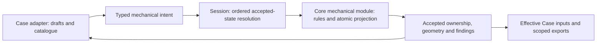

# 02: Core owns mechanical settings and linked mirrored features

Status: resolved
Type: build
Blocked by: 01, [matrix Core placement](../../matrix-layout-consistency/issues/02-core-set-matrix-placement.md), [matrix companion modes](../../matrix-layout-consistency/issues/03-core-companion-placement-modes.md)
Spec: [spec.md](../spec.md) · Map: [map.md](../map.md) · Source: [module deepening](../../module-deepening/map.md), [review candidate 04](../../../investigations/architecture-review-2026-10-07.html#c4)

Ticket 01 has settled the typed-edit pattern. This ticket combines the mechanical
ownership migration with the agreed mirrored-feature behavior. Q1-Q13 are settled;
the complete design below was confirmed on 2026-10-08. Q14 clarifies paired Disable
and was confirmed on 2026-10-09 (see Answer). Matrix Core
tickets 02/03 remain integration prerequisites.

## What to build

The Case crate's mechanical settings resolver is a web-side domain engine that answers
with `ReplaceDocument` (line numbers at `915d305c0`, orientation only):

- `MechanicalSettingsPatch` (`web/crates/case/src/mechanical_settings.rs:451`) names
  each user change (enable, closure preset/drive/installation/thread/lengths, critical
  fits, battery, processes and so on);
- `prepare_document` (`web/crates/case/src/mechanical_settings_controller.rs:400`) and
  `apply_patch` (`:767`, ~1,060 lines) apply it to a cloned document;
- defaults and normalisation live only in web (`normalize_processes` `:2090`,
  `default_process` `:2148`, `default_plate_thickness` `:2316`,
  `default_plate_foam_thickness` `:2339`, `default_gasket_layout` `:2347`,
  `default_internal_gasket` `:2362`), and two copy Core: `default_material` (`:2237`,
  Core `core/src/mechanical.rs:72`) and `mounting_datum` (`:2331`, Core
  `switch_mounting_datum` `:18`).

Move the patch into Core through one typed mechanical-edit interface carrying the
specific change. Organize patch families privately within the mechanical module.
Core owns defaults, validation, mirrored-feature propagation and closure-clearance
projection; the Case adapter owns drafts, preparation order and presentation.

Support explicit mechanical mirror pairs for both physical copies of one reversible
PCB and distinct left/right PCB designs. Mounts, openings, gasket supports, holes
and similar shared mechanical features stay reflected and linked by default. An
edit from either half updates its counterpart; exceptions belong to individual
features, so different encoders or a screen on one half do not detach the rest.
Resolve the pair effects before clearance projection, with one accepted edit and
one Undo step for the complete result.

## Acceptance criteria

- [ ] One copy of each mechanical default, in Core; the web copies are deleted.
- [ ] `battery_patch_tests` (`mechanical_settings_controller.rs:~2460-3631`) move to Core
  as tests of the operation, next to the rules they cover.
- [ ] Changed IDs are precise; the operation is classified for `affects_outline` with
  its reasoning in the doc comment.
- [ ] `MechanicalSettingsController`'s shell (ports, `flush_prepared` ordering) is
  unchanged and its native tests pass.
- [ ] The resolver inventory row for the mechanical settings resolver is updated.
- [ ] An explicit mechanical mirror pair supports both reused-PCB and distinct-PCB
  cases. Pair identity is not inferred from names, half labels or flip flags.
- [ ] Editing a linked feature from either half produces reflected counterpart
  geometry and updates generated clearance parts in the same Undo step.
- [ ] Per-feature exceptions preserve the other links. Left-only screen openings
  and differing encoder clearances are covered by the chosen exception policy.
- [ ] Pair and feature identities and exceptions survive save/reopen and Undo/Redo.
  Opening an older project preserves authored geometry/settings and does not infer
  new links. Existing explicit gasket links and unlink flags retain their meaning.
- [ ] Make local is explicit and preserves the feature's visible geometry. Later
  counterpart edits leave that local feature and the remaining pair links intact.
- [ ] Linked deletion removes both counterparts; Remove on this half persists a
  local omission. Local deletion leaves the other half untouched. Rejoining selects
  source geometry with a preview and preserves all unrelated exceptions.
- [ ] New pairs share construction within their own pair. Other pairs, local hardware
  settings and existing projects' effective construction retain their ownership.
- [ ] A geometrically valid linked placement that clashes on one half is accepted
  on both halves with a precise fit finding. Saving/editing remains available;
  affected manufacturing exports are blocked until the conflict is resolved.
- [ ] Queued edits address durable feature identities; removing or reordering an
  opening cannot redirect an earlier edit to a different opening by vector index.
- [ ] Matrix placement, authored companions, explicit constraints and half-local
  hardware retain the matrix effort's behavior. Mirror projection is applied once.
- [ ] Manually positioned/pinned supports and explicit empty mount collections keep
  their ownership; paired edits do not authorize automatic relocation of exceptions.

## Verification

```sh
cargo test -p boardstudio_core -p boardstudio-application --locked
cargo test -p boardstudio-web-case --locked
python3 scripts/check.py repo lint typecheck test browser
wasm-pack test --headless --chrome web/crates/case --locked --lib
```

## Approved spec

The user has chosen combined Core ownership, linked mirrored features, explicit
existing-project linking, explicit per-feature localization and retained fit
conflicts. Feature lifecycle, construction scope, the complete interface, persisted
representation and implementation sequence are confirmed in the Answer below.

- Add one typed mechanical Core operation carrying durable target identity, the
  specific typed change and the normalized mounting-hole catalogue definition from
  the existing adapter. The target identifies the board and physical instance when
  applicable; Core resolves any mechanical pair against the accepted document.
  Core validates the template's source identity. The confirmed interface and
  persisted pair/exception representation are specified below.
- Move the patch vocabulary, dependent field enums, defaults, normalization and
  profile-target validation into Core. Include the relevant effective-configuration
  rules currently in host Case settings and CAD input projection: shared construction,
  instance settings, board thickness, wireless battery defaults and flipped instances.
  Preserve existing constants, family inference, explicit empty mount collections
  and installation behavior. Shared construction and the new feature-pair rules
  need explicit ownership so unrelated physical instances are not accidentally
  changed by pair propagation.
- At execution, Core uses its accepted document and outline cache to initialize absent
  closure mounts through the existing mechanical resolver. Mirror physical-instance
  contours consistently with the current host projection. Core also owns the existing
  closure-clearance projection, including generated definitions, parts, references and
  board/layout memberships. Resolve linked counterpart edits and feature exceptions
  before generating those parts. Configuration, counterpart changes and projection
  form one Undo step; a failure cannot leave only one half changed.
- Return affected board owners and only durable entity IDs whose values or
  memberships actually changed: paired features, affected physical instances,
  generated parts and definitions, and relevant membership owners. Preserve
  unrelated settings and parts. Pure settings
  changes do not rebuild board outlines; projection changes are classified according
  to their effect on outline inputs, with regression coverage and a code comment.
- Equal results remain Unchanged with no history/revision step. Reuse Core evaluation
  for resolver no-op detection rather than duplicating patch rules. Vanished or
  ineligible targets retire; malformed submitted values become Core edit errors.
  A geometrically valid reflected feature that conflicts with the other half's
  hardware remains accepted with a located fit finding. Do not silently relocate
  the feature or break its link; the finding blocks only affected manufacturing
  output, while saving and further editing remain available.
- Existing projects keep their authored geometry, independent features and existing
  explicit links until the user chooses to establish new mechanical links. New
  mirrored physical pairs use linked defaults. Any schema migration needed for
  stable identity must preserve geometry and must not guess relationships from
  coordinates, names or flip flags.
- Make local explicitly creates a per-feature exception without moving the feature
  or changing the rest of the pair. Ordinary edits to a linked feature continue to
  update both halves. Deleting a linked feature removes both counterparts; Remove
  on this half creates a local omission. Deleting a local feature affects only that
  half. Rejoining or linking unequal existing halves explicitly selects source
  geometry and previews the result; unmatched features remain local and other
  exceptions remain intact.
- New mechanical pairs share construction dimensions, materials and manufacturing
  processes within the pair. Hardware-specific settings stay local; other pairs and
  unpaired instances are independent. Existing projects retain their effective
  construction settings until explicitly converted to the new ownership model.
- Preserve controller ports and `flush_prepared` ordering. Move domain-rule tests to
  Core, retain controller lifecycle/queue coverage, and add atomic projection, flipped
  instance, bidirectional paired edits, exceptions, unrelated-edit queueing, no-op
  and Undo regression tests. The accepted pair/exception state is the presentation
  source; do not introduce a second writable relationship store.
- Persist explicit pair membership and stable per-feature relationships. Mounts
  have IDs today, while opening edits use vector indices; the latter cannot be the
  identity of a queued or linked feature. Use the project's ordered migration
  conventions from [ADR-0004](../../../adr/0004-document-format-version-and-id-rename.md)
  when the schema requires a version change. The upgrade preserves the user's
  existing geometry and relationship semantics.

The scope therefore also includes the relevant host Case defaults/projection helpers
and `case/closure_clearance.rs`, beyond the original controller-only file list.
Ticket 01 and module-deepening 09 are resolved and integrated. Matrix Core tickets
02/03 own the preceding shared-file integration window. Planning and fact finding
can proceed now; shared Core implementation integrates after those matrix changes.

## Reconciliation with matrix layout consistency

Source: [matrix spec](../../matrix-layout-consistency/spec.md),
[matrix map](../../matrix-layout-consistency/map.md),
[ADR-0007](../../../adr/0007-matrix-gestures-edit-named-parameters.md).

- `SetMatrixPlacement` owns matrix parameters and linked key geometry. The mechanical
  intent owns settings and mechanical feature relationships. Neither interface
  substitutes for the other.
- Today's `LayoutMirrorLink` joins two layouts on the same board. A mechanical
  mirror pair must also cover different PCB designs and physical copies; it cannot
  reuse that link as its complete persisted representation. Mirrored-half setup
  should establish an explicit mechanical relationship for eligible physical
  targets; a Layout-only pair must not silently invent physical instances or split
  a board. Setup eligibility and conversion are specified below.
- Matrix-local switches, variants, diodes, attached hardware and independently
  placed parts remain local, as the mirrored-layout brief requires. Mechanical
  sharing does not create a second encoder or screen on the other half. Existing
  authored companion positions and explicit constraints keep their precedence.
- Core owns each transform's geometry. Mechanical projection uses the accepted
  target frames, reflecting physical instances exactly once; do not copy matrix
  splay/stagger maths into Case or confuse a global layout axis with a physical
  instance's local frame.
  Source check at `f65ed01a6`: physical `flipped` reflects board-local X about zero,
  while `LayoutMirrorLink` stores a layout-world axis. The current clearance
  projector reflects instance mounts itself. Define stored feature coordinates,
  pair mapping and assembly-to-PCB conversion together so pair propagation cannot
  reflect the same feature a second time; verify both pair modes through Core.
- For one PCB reused twice, preserve deliberate shared fabricated-hole semantics;
  for distinct PCB designs, generated parts, references and memberships stay scoped
  to their board. Explicit mechanical feature exceptions and required physical
  clearance must be reconciled by the conflict policy below, not coordinate guesses.
- Existing user-positioned supports/closures remain protected under the
  [gasket placement rules](../../../design/gasket-case-redesign.md#automatic-support-repair-and-placement-ownership).
  A matrix/outline change can repair eligible generated supports, while incompatible
  authored placement remains a finding under the chosen pair-conflict policy.
- `core/src/model.rs`, `core/src/lib.rs` and the boundary transcript fixture overlap
  with matrix tickets 02/03. Integrate and rebase on that Core series before editing
  those files; one owner regenerates the combined transcript. Matrix web/Relations
  work does not need to wait for this mechanical discussion. Do not reset either
  series to its earlier baseline.
- Integrated coverage must queue a mechanical edit behind matrix placement and the
  reverse order, then exercise Undo/Redo. Verify current geometry, local exceptions,
  stable feature identities, precise changed owners and save/reopen in both cases.
- [DESIGN.md](../../../../DESIGN.md#wiring-and-physical-assemblies) currently describes
  openings/mounts as local. The decided mirrored-feature direction here supersedes
  that blanket rule for explicit mechanical pairs. Update its wording and
  `docs/architecture.md` with the implementation; preserve unrelated in-progress
  design edits.

## Decisions — 2026-10-08

- Q1, scope (user: "together"): move mechanical settings mutation and its generated
  closure-clearance projection into Core together. Configuration, mount
  initialization when required, generated definitions/parts and affected memberships
  remain atomic, with one Undo step per edit. A settings-only migration with a later
  projection follow-up is not the chosen scope.
- Q2, mirrored behavior: mirrored halves should share reflected mount positions,
  openings, gasket supports, holes and similar mechanical features by default, and
  keep those features linked. Deliberate exceptions accommodate different encoders,
  a screen on one half and other half-specific hardware. This supersedes a blanket
  preservation of today's independent spatial-feature editing. Q5-Q7 settle pair
  coverage, propagation direction and exception granularity; existing-project and
  detailed exception behavior are settled by Q8-Q12 below.
- Q3, preferred interface (user: "one typed interface i think?"): one typed
  mechanical-edit interface carrying the specific change, with patch families
  organized privately inside the Core module. This is the recommended direction;
  the exact operation and payload are specified in the confirmed design below.
- Q4, catalogue input (user: "keep"): retain the existing catalogue adapter supplying
  the normalized mounting-hole definition. Core validates that input and owns
  projection; catalogue loading stays outside Core.
- Q5, pair coverage (user: "both"): support physical copies of one reversible PCB
  and distinct left/right PCB designs through an explicit mechanical relationship.
  Mirrored-half setup establishes it for eligible physical targets; independently
  created halves require an explicit link.
- Q6, propagation (user: "yes"): edits can originate on either half and update
  the reflected counterpart together in one Undo step.
- Q7, exceptions (user: "per feature"): a half-specific addition, differing feature
  or omission affects only that feature. The rest of the mechanical pair stays linked.
- Q8, existing projects (user: "keep explicit"): do not automatically establish
  mechanical links or change authored geometry on open. New mirrored physical
  pairs use the linked defaults. Redo all included keyboards as a separate
  [follow-up](04-refresh-included-keyboards.md) once the new behavior is settled
  and implemented.
- Q9, local exceptions (user: "explicit make local"): ordinary shared-feature edits
  retain the link. Make local is an explicit action scoped to the selected feature.
- Q10, conflicts (user: "retain with finding"): retain a geometrically valid
  mirrored change even when it conflicts with the other half. Show a located fit
  finding and block affected manufacturing output; do not automatically unlink or
  reposition it. Malformed data still follows the Core error contract.
- Q11, deletion (user: "yes"): deleting a linked feature removes both counterparts.
  Remove on this half explicitly creates a local omission; deleting an already-local
  feature affects only that half.
- Q12, rejoining/linking (user: "yes"): explicitly choose source geometry and preview
  the result before applying. Features without a counterpart stay local; unrelated
  feature exceptions remain intact.
- Q13, construction scope (user: "yes"): new pairs share case dimensions, materials
  and manufacturing processes within the pair. Hardware-specific settings remain
  local, other pairs remain independent, and existing projects retain effective
  settings until explicitly converted.
- The complete interface and implementation plan were confirmed after Q1-Q13;
  see Answer below.

## Confirmed design

The following technical choices implement Q1-Q13 and were included in the final
shared-understanding review confirmed by the user on 2026-10-08.

### Module and interface

Deepen the Core mechanical module. Its interface describes the requested change;
defaults, effective settings, feature ownership, transforms, validation and generated
clearance parts sit behind that seam. This provides locality for domain rules and
leverage through both browser and native adapters. Tests exercise the interface.



- Add `EditOperation::ApplyMechanicalEdit { edit: MechanicalEdit }`.
  `MechanicalEdit` contains a typed target, a typed change and optional normalized
  mounting-hole input. The target is `Board { board_id }` for the existing canonical
  configuration or `Instance { instance_id }` for a physical half. Resolve its board
  and pair from the accepted document; do not accept a second, potentially conflicting
  board ID for an instance. Keep existing target-eligibility guards.
- Move the domain payload of `MechanicalSettingsPatch` into the Core change
  vocabulary. Add explicit pair linking and feature sharing actions: Make local,
  Remove on this half and Rejoin. Linking carries the other instance ID, mapping,
  selected construction source and explicit feature correspondences. UI field IDs,
  labels, drafts and catalogue loading remain in Case. Private files may organize
  settings, features, pairing and clearance projection; do not expose their helpers.
- Add one synchronous read-only function in Core's mechanical module,
  `evaluate_edit(document, board_contours, edit) -> Result<MechanicalEditDisposition, String>`.
  Its disposition is Changed, Unchanged or Retire. Case already depends directly on
  Core and has the accepted document and resolved board contours; no new worker
  request, asynchronous port or public outline-cache type is needed.
- Provide the shared read path as
  `effective_inputs(document, board_contours, target) -> Result<MechanicalInputs, String>`.
  `MechanicalInputs` carries the resolved configuration, effective part/contour
  projection and scoped findings with the context needed by the existing mechanical
  resolver. `captured_case_document`/`effective_case_inputs` become adapters over
  this Core projection. Use its result for views and CAD job inputs; commits continue
  to carry typed changes against accepted state. Evaluation, apply and findings
  reuse the same private effective-input rules.
- The evaluator and Core apply share one private implementation. The evaluator
  exposes no prepared replacement document. Core apply evaluates against operation-time
  state and performs the complete mutation, projection and change reporting. A
  mechanical no-op also short-circuits direct Core commits before revision/history
  mutation. Do not change the no-op policy of unrelated operations in this ticket.
- Missing or ineligible targets retire in the adapter. Structurally malformed values
  or catalogue input produce Core errors. A valid geometric clash is an accepted
  finding. Preserve `Result<_, String>` and the existing edit-ticket settlement rules.
- Require the normalized mounting-hole definition whenever projection must create
  or update a generated closure-hole footprint. Missing required input is an edit
  error with no mutation, not retirement. Edits that need no such creation/update
  may omit it, including removal of the last generated hole. Validate source identity
  and structure whenever a template is supplied; retain catalogue loading in Case.

The required public Core contract additions are the single operation and its typed
payload, persisted ownership types, the evaluation and effective-input read paths,
and mechanical finding/projection data needed by presentation. No existing private
helper or cache needs wider visibility.

### Stored ownership and identity

- Add explicit mechanical pairs under `HardwareConfiguration`. A
  `MechanicalMirrorPair` has a stable ID, exactly two physical instance IDs, their
  mapping, one `MechanicalConstruction` value and linked-feature records. An
  instance belongs to at most one mechanical pair. Validate member existence,
  feature kinds/identity, finite mapping values and ownership consistency.
- `MechanicalConstruction` contains the shared construction subset rather than a
  second full configuration: case/plate method and style, frame/dimensional/foam
  settings, common gasket dimensions/material, manufacturing processes/materials
  and generic closure recipe. Board identity/thickness, batteries, part profiles,
  stabilizer overrides and hardware-specific fits/specifications remain local.
  References required by a linked mount's closure recipe are projected for each
  member's features; they do not identify the other half's electrical hardware.
- Each linked-feature record has its own stable relationship ID, feature kind,
  one authored value with its authoring member, and the member-specific feature IDs
  and states. States are Linked, Local or Omitted. Store the linked value once;
  derive counterpart geometry in Core. Local geometry belongs to that instance's
  ordinary configuration. Do not also persist the effective counterpart as an
  independently writable configuration value.
- Initial editable kinds are ordinary mounts/case holes, closure mounts, authored
  Case openings and gasket support anchors. Existing intra-half gasket pairing and
  explicit `unlinked` semantics remain distinct and keep their meaning.
  Source PCB drills, footprint/profile cutouts and attached electrical hardware
  remain owned by their part/definition; this edit does not mirror those source
  records. Generated closure PCB holes are derived from the mechanical features.
- Give authored openings and their editable vertices stable IDs. Use an identified
  opening/vertex type only for `MechanicalConfiguration.openings`; retain plain
  `CaseOpening` for profile/derived geometry. Address queued opening and vertex
  changes by ID, never by their current array position. Preserve IDs when moving,
  localizing or reordering. A deliberate topology replacement invalidates removed
  vertex IDs; a queued edit to one retires rather than targeting another vertex.
- Generated clearance parts/definitions and resolved gasket supports remain
  projections. They are not another authoritative set of pair relationships.
  Core's effective mechanical view is shared by Case presentation, CAD, checks
  and exports; adapters must not reimplement inheritance or feature propagation.

### Frames and geometry

- Preserve legacy coordinate meanings: canonical configuration geometry is in its
  board's document frame; physical-instance configuration geometry is in that
  instance's Case frame. Profile geometry remains footprint-local. Core owns the
  conversions and provides effective parts, contours and mechanical inputs together.
- Store the pair map as a `Pose2` composed with a fixed X reflection. For member
  A to B, `q = R(rotation) * (-p.x, p.y) + at`; use its exact inverse for B to A.
  Rotation uses the existing degree convention. This supports translated/rotated
  distinct boards without treating `LayoutMirrorLink.axisX` as a physical frame.
  Setup supplies the map explicitly; do not infer it from part coordinates or names.
- Same-PCB opposite-flip copies use the corresponding physical reflection. Convert
  instance Case geometry back into fabricated board coordinates once when generating
  PCB clearance parts. The physical flip can cancel the pair reflection; applying
  both twice would move the holes incorrectly. Verify forward/inverse maps and all
  supported flip combinations with asymmetric fixtures.
- Transform planar orientation by `angle_B = rotation - angle_A`. Map vectors with
  the linear reflection/rotation, keeping translations out of them. Reflection
  reverses polygon winding: reverse the projected opening vertex sequence while
  preserving vertex IDs, and make support tangents follow the resulting contour
  winding. Preserve Case-feature Z/height; physical board-face/profile handling
  stays in the effective-instance projection. Cover asymmetric openings, directions
  and inverse edits so a second reflection cannot hide in symmetric geometry.
- Resolve gasket anchors against their authoring member's accepted contours, then
  mirror the resolved support geometry, tangent/normal and winding consistently.
  Counterpart outline/region association is derived against its actual contours.
  An incompatible counterpart contour retains the intended reflected placement
  with a fit finding; do not snap it to another track or reinterpret the same anchor
  fraction on an unrelated contour. User/pinned placement keeps its ownership.
- Preserve clearance deduplication by board ID and XY rounded to five decimal
  places, taking the largest required diameter. One PCB used twice has the union
  of required physical-instance holes in its single fabrication design, including
  holes needed by a local exception. Distinct PCB designs retain separate holes,
  generated IDs, definitions and board/layout memberships.
- Preserve today's projection scope: closure mounts generate PCB clearance parts.
  Ordinary mounts/case holes mirror their Case/plate geometry; pairing them does
  not automatically introduce a new fabricated PCB drill or rewrite a source hole.

### Lifecycle, setup and reviewed linking

- New explicit mirrored physical-half setup establishes a pair and links eligible
  generic mechanical features. Generic feature additions on a pair are Linked by
  default; Add only on this half is explicit. Hardware-derived requirements stay
  bound to their local hardware, with deliberate feature exceptions visible.
  Layout-only mirroring does not create physical topology as a side effect.
- Existing independent halves link only through an explicit action. Both instances
  must exist, refer to existing boards and be available for this pair. Reused-PCB
  mirrored setup uses opposite physical orientation; distinct-PCB setup carries its
  declared mapping. Do not guess eligibility from a `half` label or board name.
- The review selects source geometry for each matched feature and a source for
  construction settings, shows the complete proposed result/findings on both halves,
  and leaves unmatched features local. Accepted linking consolidates selected
  shared values into the pair in one edit, preserving member feature identities
  and unrelated authored features.
- Ordinary edits from either member update the shared feature. Make local materializes
  its current effective geometry on the selected half without moving it. Remove on
  this half stores an omission. Linked Delete removes both; local Delete removes
  only that half. Rejoin selects the source explicitly, reviews the resulting
  geometry, then clears only that feature's local/omitted exception.
- Reviewed linking/rejoining submits IDs, choices and a fingerprint of the reviewed
  inputs. At execution, resolve against the accepted document. If relevant source,
  destination or mapping inputs changed, retire and refresh the review; unrelated
  edits do not invalidate it. This prevents applying a result the user has not seen
  and avoids submitting a captured whole document.
- Removing a physical member preserves the surviving half's visible mechanical
  geometry and construction by materializing them locally, then removes the pair.
  Validate/clean ownership through Core so existing topology actions cannot leave
  dangling feature references. A queued edit to a removed member retires.

### Existing projects and migration

- Append the ordered 2-to-3 document migration under
  [ADR-0004](../../../adr/0004-document-format-version-and-id-rename.md). Assign
  deterministic, collision-free identities to existing authored openings/vertices
  in canonical, instance and legacy shared configurations, without moving geometry.
  Do not create mechanical pairs, infer correspondences or alter existing gasket
  links/omissions. New projects write the current version from creation.
- Add explicit construction ownership: Legacy, Local or Pair. Migration marks
  existing physical instances Legacy, preserving today's effective shared overlay
  and first-instance fallback even when `construction_linked` was false. New
  unpaired instances use Local; new pairs use their pair's construction. Retire
  `construction_linked` as an authority rather than repurposing its unused value.
- On explicit conversion, resolve the selected members' current effective values
  before changing ownership. Materialize currently overlaid `hardware`,
  `criticalFits` and `profiles` into each selected member's local configuration,
  alongside its other hardware-specific values, before removing the legacy overlay.
  Keep the remaining Legacy instances' baseline intact;
  if their old shared source was a converted instance, capture the prior common
  construction as the legacy source before conversion. Pair changes must never
  feed back into that source. Other pairs and Local instances remain independent.
- Exercise migration through native archive load and browser storage load/writeback,
  then save/reopen and Undo/Redo. An identity migration may change serialized shape;
  it must preserve geometry, effective settings and the absence of inferred links.

### Findings, change reporting and cache effects

- Recompute pair fit findings from accepted state; do not persist a second mutable
  findings store. Include pair, instance, feature and affected board identity plus
  location so the user can select the problem. The intended geometry remains
  visible even when manufacturing generation is blocked.
- A Case fit conflict blocks manufacturing output for its affected physical assembly.
  If projected drill geometry violates the PCB's manufacturing requirements, attach
  a PCB finding to that board and block its PCB export too. A Case-only clash must
  not block an unrelated board's KiCad output. Same-PCB members share fabrication
  effects; two distinct boards have independently scoped readiness.
- Wire these findings into Core's accepted scene/readiness and the selected-assembly
  export gate. Existing transient assembly diagnostics alone do not provide the
  complete accepted-state contract. Saving and further edits remain available.
- Changed IDs cover only changed pair/construction/feature owners, affected physical
  instances/boards and generated parts/definitions/memberships. Compare actual
  durable values, including removals, rather than reporting the whole document.
- The mechanical evaluator reports whether actual outline inputs changed. Pure
  settings and outline-excluded clearance projection preserve the outline cache;
  rebuild only changed inputs when required. Keep other operations' classification
  unchanged. Record the reasoning in the new operation's documentation.

### Implementation order and verification

This order describes work within ticket 02; it does not approve partial delivery of
the combined feature. Use one owner for shared Core files and boundary fixtures.

1. Integrate on matrix Core 02/03. Establish identified openings/vertices,
   pair/construction ownership types and the ordered migration. Test unchanged
   legacy geometry/effective configuration, stable reload IDs and no inferred links.
   Test explicit conversion with conflicting stored versus overlaid hardware/profile/
   fit values and a third legacy instance using the converted member as its fallback.
2. Implement Core evaluation and the typed edit with defaults, validation, absent
   mount initialization and clearance projection together. Test precise IDs,
   direct/resolver no-ops, malformed-input rollback and one complete Undo step.
   Preserve `None` versus explicit empty closure collections.
3. Implement shared effective inputs and pair propagation for both PCB modes,
   then explicit local/omitted/rejoin/delete behavior, source review and findings.
   Cover either edit direction, inverse maps, asymmetric outlines, local hardware,
   pinned supports, shared-board hole union/dedup and distinct-board isolation.
4. Migrate the Case controller and relevant host projection/default helpers to
   adapters over Core. Keep async catalogue preparation and `flush_prepared` order.
   Add physical setup/linking and per-feature actions using the accepted model;
   update DESIGN/architecture wording while preserving concurrent edits.
5. Verify at the Session/Core seam: matrix then mechanical, mechanical then matrix,
   unrelated edits during preparation, deleted/reordered features/vertices, stale
   reviewed inputs, fit conflicts, exact output gates, Undo/Redo and archive reopen.
   Regenerate the combined native/WASM transcript once after integration. Update
   the resolver inventory and remove superseded web mutation/default tests after
   equivalent behavior is covered through the Core interface.

Source evidence at `f65ed01a6`: `model.rs` has no opening/vertex identity or general
mechanical pair; `migrate.rs` is version 2. The Case crate already depends on Core.
`AcceptedSnapshot.scene.board_contours` supplies accepted contours while Core's
outline cache remains private. `lib.rs` currently increments history even if apply
reports no changed IDs, so the mechanical no-op short-circuit must land with the
operation. Host Case export already gates assembly Error diagnostics; KiCad export
uses PCB readiness and needs PCB-scoped findings for affected drill geometry.

Run the affected checks listed above, including browser storage/controller/setup
coverage, and the full `python3 scripts/check.py` before a PR. Both Standards and
Spec reviews must cover the integrated implementation before resolving ticket 02.
Only then start [refreshing the included keyboards](04-refresh-included-keyboards.md).

## Answer

On 2026-10-08, after reviewing Q1-Q13 and the complete design, the user confirmed
the shared understanding ("understood"). This confirms the typed mechanical
interface and listed public contract additions, persisted ownership and migration,
coordinate conventions, lifecycle/findings behavior and implementation order.
The architecture skill's grilling confirmation gate is satisfied; ticket 02 is
`ready-for-agent`, with matrix Core tickets 02/03 still required before shared Core
implementation. The included-keyboards refresh remains the separate ticket 04
follow-up after implementation and integrated verification.

This records design approval. It does not resolve the build ticket or its integration
prerequisites; implementation, source/browser checks and required reviews remain.

This reconciliation is documentation only. It does not claim implemented mirrored
mechanical links or fresh source/browser verification. Before a PR, run the full
`python3 scripts/check.py` on the integrated source and complete both required reviews.

### Q14: Unlink and disable this half — 2026-10-09

The user selected **Unlink and disable this half**. For a paired physical instance,
the UI explicitly names both effects. Submit the existing typed `Disable` change
once, not separate Unlink and Disable requests or a replacement document.

Core materializes both members' current effective geometry, construction and local
settings, clears the pair and its ownership references, then disables only the
selected half's mechanical stack. The other half keeps its geometry and settings.
Both physical instances, PCBs, electrical parts and unrelated split/layout settings
remain. Update affected generated holes and memberships in the same staged edit.
One Undo restores the whole change; Redo repeats it. Validation or missing required
input rolls back everything. A supplied mounting-hole template is validated; it is
required only for actual generated-hole creation/update, not deletion or unchanged
holes alone.

A pending settings/geometry edit to the disabled stack retires as ineligible even
though the physical instance still exists. Enable remains possible and does not
infer a new pair. Opening/vertex identity reservations must survive the lifecycle
so a later recreated feature cannot receive an earlier pending edit. Existing
unpaired/canonical Disable behavior remains unchanged.

Verify through the public Core operation/evaluator, real Session/Core and mounted
controls: explicit action, preserved survivor, no PCB/instance removal, one
Undo/Redo, atomic rollback, queued retirement and save/reopen without relinking.
This is design approval, not implementation acceptance or ticket closure.

## Comments

### Progress — step 1 complete (commit `c77ab3a6f`)

Branch `typed-core-edits/mechanical`, based on the integrated matrix work at `d543201a8`
(`typed-core-edits/matrix-core`). Matrix Core 02/03 verified present and resolved first.

Implemented and verified:

- `MechanicalConfiguration.openings` is `Option<Vec<MechanicalOpening>>`, where each
  opening and vertex has a stable `id` and geometry is unchanged. `CaseOpening`
  remains for profile/derived geometry; adapters convert at their boundary.
- `HardwareConfiguration.pairs` (explicit `MechanicalMirrorPair`s), `MechanicalConstruction`
  (the shared subset: method/style, dimensional/foam, gasket, processes/materials,
  internal gasket, gasket layout), `MechanicalFeature`/`MechanicalFeatureMember` with
  `MechanicalFeatureKind`/`MechanicalFeatureState`/`MechanicalFeatureValue`. Pair
  mapping is a `Pose2` composed with a fixed X reflection.
- `PhysicalBoardInstance.construction_ownership` replaces the retired
  `construction_linked` (whose value never affected the effective overlay).
- Ordered 2-to-3 migration (`CURRENT_VERSION = 3`): assigns deterministic
  `opening-N`/`vertex-N` identities in the canonical, instance and legacy shared
  configurations, preserves geometry, marks every existing instance `legacy` and
  removes the old flag. It creates no pairs and infers no correspondences.

Verification: `cargo test -p boardstudio_core` (175 unit + 349 integration),
`-p boardstudio-application` (30), `wasm-pack test web/crates/case` (77), WASM
`typecheck`, `cargo fmt --check`, `cargo clippy --workspace --all-targets -D warnings`,
and GitNexus `detect-changes` (23 files, 117 symbols, risk medium; 4 mechanical
generation flows). The boundary transcript, `reviung41` fixture and the demo
baseline were updated for the version/ownership representation change.

### Next — step 2

Move the `MechanicalSettingsPatch` domain vocabulary and defaults into Core behind
`EditOperation::ApplyMechanicalEdit { edit: MechanicalEdit }`, and implement
`evaluate_edit`/`effective_inputs`/apply with validation, absent mount
initialization, closure-clearance projection and the no-op short-circuit. The patch
enum payload uses only Core types; `field_id()`/`NumberRule` stay in Case as a
Case-side extension trait. Then steps 3-5 (pairs/features/findings, Case adapter,
integrated verification) per this ticket.

Note: the GitNexus MCP server is now configured for pi (`/home/chris/01_Projects/ts-boardstudio2/.pi/mcp.json`,
project scope, direct exposure, `cwd` = this worktree); it serves the worktree index.

### Progress — slices charted and two parallel slices landed

Split the remaining build into child tickets (05-10) with blocking edges:
05 Core effective inputs, 06 Core apply settings, 07 Core closure-mount
initialization and clearance projection, 08 Core mirror pairs and linked
features, 09 Case adapter and setup, 10 integrated verification and reviews.

Landed so far on `typed-core-edits/mechanical`:

- `c77ab3a6f` identified openings, pair/construction ownership and the 2-to-3 migration.
- `7e1ec0e04` moved the `MechanicalSettingsPatch` vocabulary into
  `core::mechanical::change` behind `EditOperation::ApplyMechanicalEdit`.
- `043a0604e` moved the mechanical defaults into Core and deleted the Case copies.
- Parallel slice (branch merged): `925f0083a` moved the closure-clearance projection
  into `core::mechanical::clearance`, with the Case file now a thin adapter.
- Parallel slice (branch merged): `4bde2993f` added the pair geometry helpers in
  `core::mechanical::pair` (forward/inverse map, orientation involution, opening
  reflection with preserved vertex ids and reversed winding).
- `8aa0423ba` corrected pair orientation recovery to the reflection involution.

Verification: `cargo test -p boardstudio_core` 192 unit + 349 integration,
`wasm-pack test web/crates/case` 77, WASM `typecheck`, `fmt`, `clippy`, and
GitNexus `detect-changes` (5 files, 67 symbols, medium risk, 2 mechanical flows).

Next: slice 05 (`effective_inputs`) and slice 06 (`apply` settings families),
then 07-10.

### Progress — slices 05 and 06 landed

- Slice 05 (Core effective inputs, `e1de79af7`): `core::mechanical::inputs::effective_inputs`
  resolves canonical, Legacy overlay with first-instance fallback, Local, Pair,
  board thickness, wireless battery defaults and flipped instances; the host
  `effective_instance_configuration` is now a thin adapter over it.
- Slice 06 (Core applies settings, `3fbce5418`): `core::mechanical::edit::apply`
  ports the whole settings vocabulary (enable/disable, battery, closure hardware,
  critical fits, hardware, openings, method/mount collections, dimensions, gasket
  support placement, profiles, switch family, processes, stabilizers) with
  validation, rollback on malformed input, precise changed ids and no-op detection.
  Closure-mount initialization and clearance projection are deliberately deferred to
  slice 07 (documented `TODO(slice 07)`); the Case controller still holds its own
  `apply_patch` until slice 09.

Verification: `cargo test -p boardstudio_core` 219 unit + 349 integration; Case WASM
tests 77; host `page` tests 12; WASM `typecheck`; `fmt`; `clippy`; GitNexus
`detect-changes` medium risk.

Known follow-up for slice 08: instance persistence currently writes only
`instance.mechanical`, so a Legacy instance overlaid from a distinct
`shared_construction` can have an overlaid-field change reverted on the next read.
Construction ownership and pair scope must settle that.

### Progress — implementation finished and reviewed (2026-10-09)

All slices 05-10 completed across two implementation lanes (Core: `typed-core-edits/mechanical-integration`;
Case/UI: `typed-core-edits/mechanical-actions`) and integrated on this branch through `2a8d5e076`.
The complete `python3 scripts/check.py` passed on the integrated source (parent checkout + non-nested
validation worktree, same commit, each owning the steps its environment supports), the boundary
transcript reproduces byte-for-byte (native golden + WASM host parity), and real Session/Core queue,
Undo/Redo, save/reopen and browser IndexedDB round-trips pass. Independent Standards and Spec reviews
ran over the phase range `d543201a8...3a00845c`; every blocker they raised was fixed and re-verified
(new-instance `Local` stamping `a67c266a2`, linked changed-id completeness `acf3d332b`, Core-owned
case-admission predicate `d6ef1715b` with the page adoption `2a8d5e076`), and the full check repassed
after the fixes. Per-ticket evidence is in the Outcomes of 05-10.

### Ratified wire shape

The mechanical change vocabulary is frozen with this consciously ratified naming: variant tags are
kebab-case (`remove-physical-instance`, `materialize-legacy-construction`), struct-variant payload
fields retain snake_case (`pair_id`, `construction_source`), and `MechanicalTarget` plus the
correspondence records use camelCase (`boardId`, `instanceId`, `sourceInstanceId`) with `kind` tags.
The mixed spelling between the target and the change payload is deliberate; do not "fix" it without
a new wire-format decision, because persisted documents and the boundary transcript encode this shape.

### Accepted deviations and limits (from the reviews)

- `UnlinkMirrorPair` is a Core-tested primitive with no reachable UI control this phase: Q14's compound
  unlink-and-disable is the surfaced pair-dissolution path. Surfacing a pure unlink remains a product
  decision, not a defect.
- Physical-instance removal is paired-only; removing an unpaired instance stays with the topology
  replacement path, which reconciles pairs and materializes survivors.
- The Legacy construction conversion is a single-half UI action by design (Core accepts a member
  list; no batch control is specified).
- Outline cache classification for mechanical edits is static (`affects_outline` aliases projection
  need) and the cache recomputes projecting inputs; the projection implies the composer inputs that
  changed, so per-input rebuild bookkeeping is not required for correctness.
- Browser storage round-trip tests live in the host crate (`storage_lifetime_tests.rs`), which the
  browser step of the full check covers.
- Legacy ownership is stamped exclusively by the v2-to-v3 migration; newly created instances are
  `Local` until an eligible pair link promotes them.

## Outcome

Resolved 2026-10-09. The typed mechanical interface, Core-owned defaults/validation/effective
inputs/findings, mirror pairs with per-feature sources, atomic lifecycle (link/unlink, make local,
omit, rejoin, removal, Q14 paired disable, legacy conversion), durable identity reservations,
author-contour gasket resolution, per-target Case admission and selected-board export gating, and
the Case adapters with reviewed fingerprints and a read-only projection port are implemented,
integrated, fully checked and independently reviewed with all blockers fixed. The included-keyboards
refresh (ticket 04) remains blocked by matrix integrated verification (matrix 11).
